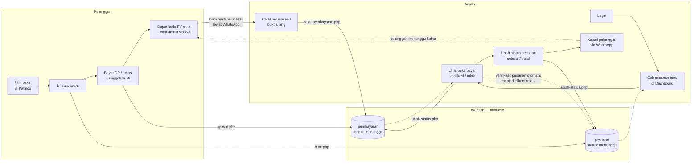
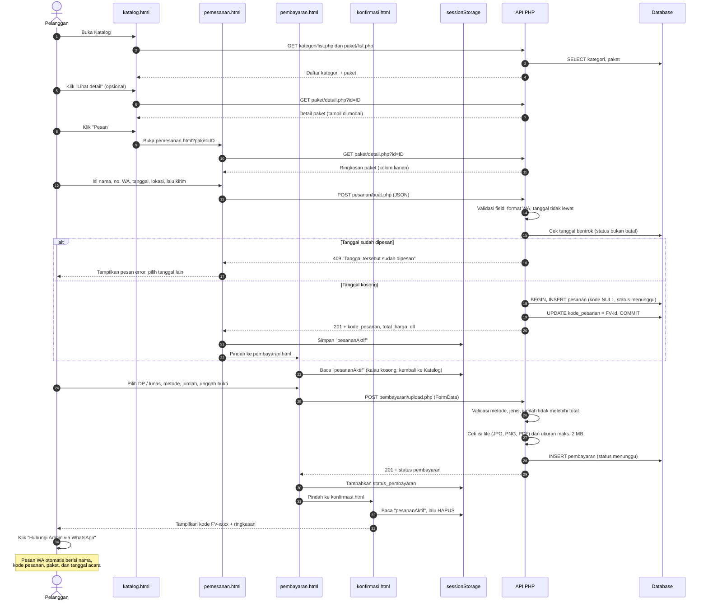
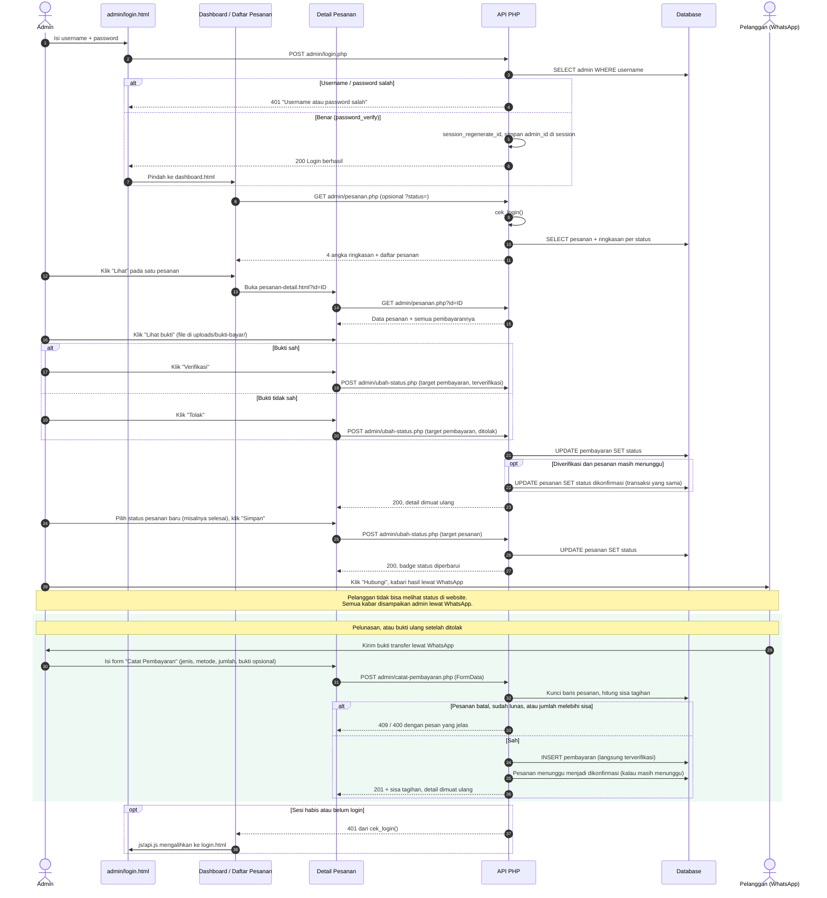
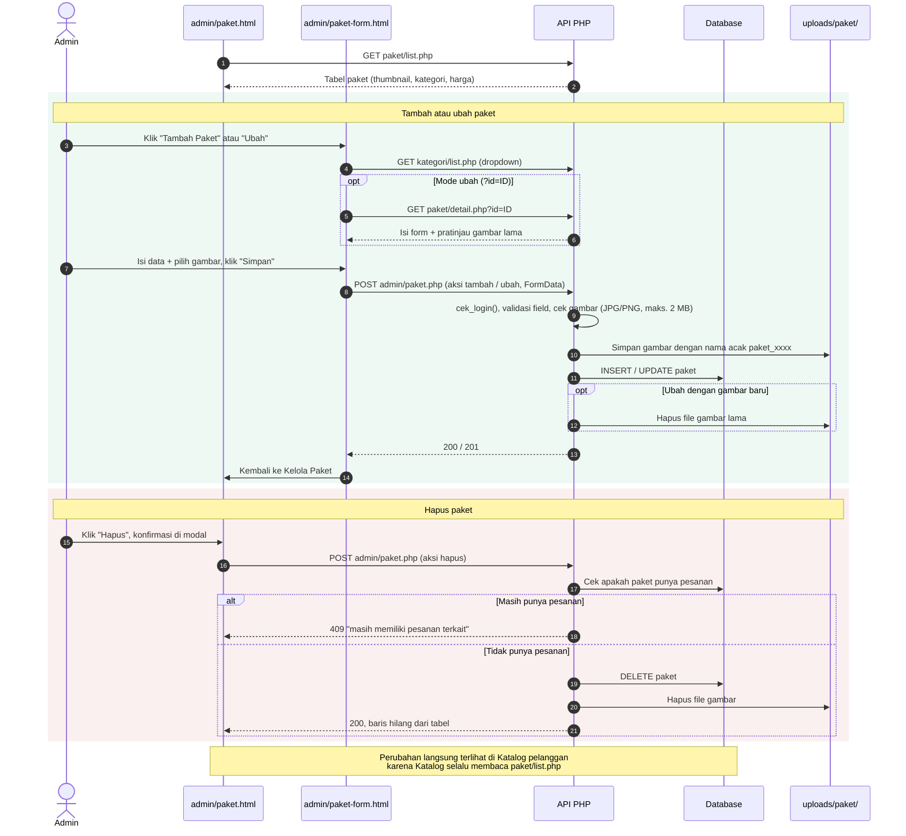
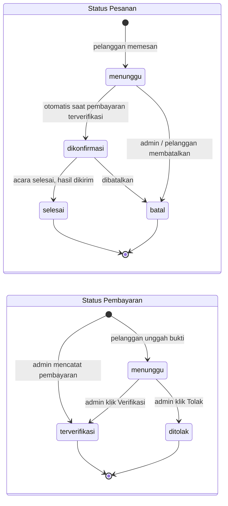

# Alur Sistem — Website Pemesanan Jasa Foto & Video

> **Status: final (2026-11-12).** Disusun dari kode yang ada di repository.
> Dua keputusan kelompok sudah dimasukkan: pelunasan / bukti ulang dicatat
> admin (bagian 3), dan verifikasi pembayaran otomatis mengonfirmasi pesanan
> (bagian 5). Lihat bagian 6 untuk ringkasan keputusan dan batasan sistem.

Pelengkap `SITEMAP.md` (halaman apa saja) dan `ERD.md` (data apa saja).
Dokumen ini menjelaskan **urutan kejadian**: siapa melakukan apa, halaman
mana memanggil endpoint mana, dan data apa yang berubah di database.
Semua diagram ditulis dengan **Mermaid** (cara melihatnya ada di bagian bawah).

---

## 1. Gambaran Besar



Inti alurnya: **pelanggan membuat data, admin memeriksa dan mengubah
statusnya, dan komunikasi selanjutnya lewat WhatsApp** (tidak ada halaman
cek status untuk pelanggan). Pembayaran berikutnya (pelunasan, bukti ulang)
dikirim pelanggan lewat WhatsApp dan **dicatat admin** di Detail Pesanan.

---

## 2. Alur Pemesanan oleh Pelanggan



Catatan:

- `total_harga` **tidak dikirim** dari frontend. Server menyalinnya dari harga
  paket saat itu (lihat `ERD.md`, catatan perancangan nomor 1).
- Tanggal dianggap bentrok kalau ada pesanan lain di **tanggal yang sama**
  dengan status apa pun **selain batal**, berapa pun paketnya.
- Data di Pembayaran dan Konfirmasi diambil dari `sessionStorage`, bukan dari
  API, karena tidak ada endpoint publik untuk membaca pesanan.

---

## 3. Alur Pemeriksaan oleh Admin



Catatan:

- **Konfirmasi otomatis:** begitu ada pembayaran terverifikasi (lewat tombol
  Verifikasi atau form Catat Pembayaran), pesanan yang masih "menunggu"
  langsung menjadi "dikonfirmasi". Pesanan yang sudah dikonfirmasi, selesai,
  atau batal tidak diubah. Status "selesai" dan "batal" tetap diatur admin
  lewat dropdown.
- **Pembayaran yang dicatat admin langsung terverifikasi**, karena admin sudah
  memeriksa buktinya sendiri. Bukti boleh tidak dilampirkan (misalnya admin
  sudah mengecek mutasi rekening). Jumlahnya dibatasi sisa tagihan.
- Semua endpoint di `api/admin/` (kecuali `login.php`) memanggil `cek_login()`
  dulu. Tombol "Keluar" di sidebar memanggil `logout.php`, lalu kembali ke login.

---

## 4. Alur Kelola Paket oleh Admin



---

## 5. Perubahan Status



Diagram di atas adalah **alur yang dimaksudkan**. Di kode sekarang:

- Perpindahan **menunggu → dikonfirmasi terjadi otomatis** saat pembayaran
  pertama terverifikasi (lewat tombol Verifikasi atau form Catat Pembayaran).
  Admin tetap bisa mengubahnya manual kalau perlu.
- `ubah-status.php` **tidak membatasi urutan**: admin bisa memilih status apa
  saja dari dropdown, termasuk mengembalikan "selesai" ke "menunggu".
- Tombol Verifikasi/Tolak hanya muncul untuk pembayaran berstatus "menunggu",
  jadi pembayaran yang sudah diverifikasi/ditolak tidak bisa diubah lagi
  lewat tampilan (tapi API-nya tetap mengizinkan).
- Pesanan berstatus **batal** membuat tanggalnya bisa dipesan orang lain lagi.

---

## 6. Keputusan Alur dan Batasan Sistem

### Keputusan kelompok (2026-11-12)

1. **Pelunasan dan bukti ulang dicatat admin.** Halaman Pembayaran pelanggan
   hanya bisa dipakai tepat setelah memesan (datanya dari `sessionStorage`,
   dan dihapus di halaman Konfirmasi). Karena itu pelunasan setelah DP, dan
   bukti ulang setelah bukti pertama ditolak, dikirim pelanggan **lewat
   WhatsApp**, lalu admin mencatatnya lewat form **"Catat Pembayaran"** di
   Detail Pesanan (`api/admin/catat-pembayaran.php`). Pilihan lain yang
   dipertimbangkan: hanya lewat WhatsApp tanpa dicatat di sistem, atau
   halaman "Bayar Pelunasan" untuk pelanggan.

2. **Verifikasi pembayaran otomatis mengonfirmasi pesanan.** Pesanan
   "menunggu" langsung menjadi "dikonfirmasi" begitu ada pembayaran
   terverifikasi, dalam satu transaksi database.

3. **Tidak ada halaman Cek Status untuk pelanggan.** Endpoint
   `api/pesanan/status.php` yang sempat dibuat sudah dihapus.

### Batasan sistem (disadari, tidak diperbaiki dalam lingkup tugas ini)

1. **Urutan status tidak dibatasi** (lihat bagian 5). Admin bisa memilih
   status apa saja dari dropdown.
2. **Pembayaran dari pelanggan tidak dicek terhadap sisa tagihan.**
   `upload.php` hanya memastikan *satu* kiriman tidak melebihi `total_harga`.
   Pembayaran yang dicatat admin sudah dibatasi sisa tagihan.
3. **Pelanggan tidak bisa mengunggah sendiri setelah meninggalkan halaman
   Pembayaran**, sehingga bergantung pada admin untuk mencatat pembayaran
   berikutnya (lihat keputusan 1).

---

## Cara Melihat Diagramnya

**Di VS Code:** pasang ekstensi *Markdown Preview Mermaid Support*
(`bierner.markdown-mermaid`), buka file ini, tekan `Ctrl+Shift+V`.

**Di GitHub:** push file ini, lalu buka di GitHub — diagramnya langsung tampil.

**Untuk laporan atau slide:** buka <https://mermaid.live>, paste isi salah satu
blok ```mermaid``` di atas, unduh sebagai PNG atau SVG.
