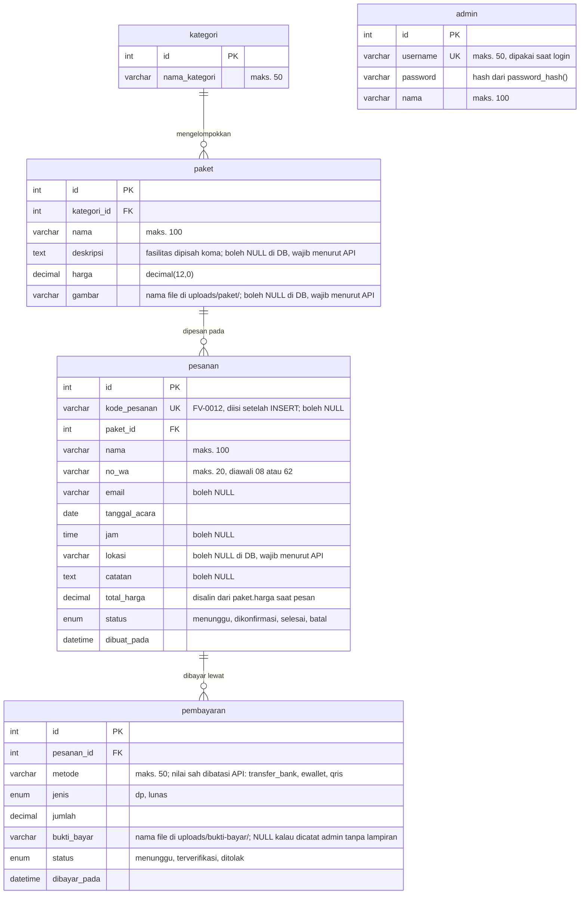

# ERD — Website Pemesanan Jasa Foto & Video

Diagram ditulis dengan **Mermaid**, jadi file ini tetap berupa teks biasa:
bisa dibaca dan diperbarui Claude Code, masuk ke git, dan otomatis tampil
sebagai gambar di GitHub maupun di VS Code (lihat cara melihatnya di bagian
bawah).

---

## Diagram



---

## Penjelasan Relasi

| Relasi | Jenis | Keterangan |
|---|---|---|
| `kategori` → `paket` | 1 ke banyak | Satu kategori (Wedding, Wisuda, Event) menaungi banyak paket. Satu paket hanya punya satu kategori. |
| `paket` → `pesanan` | 1 ke banyak | Satu paket bisa dipesan berkali-kali. Satu pesanan hanya memuat satu paket. |
| `pesanan` → `pembayaran` | 1 ke banyak | Satu pesanan bisa punya lebih dari satu pembayaran (contoh: DP dulu, lalu pelunasan, atau kirim ulang bukti setelah ditolak). |

**Tabel `admin` sengaja berdiri sendiri, tanpa relasi ke tabel lain.** Tabel ini
hanya dipakai untuk login (session PHP). Sistem tidak mencatat admin mana yang
mengubah status pesanan, karena cuma ada satu akun admin dan fitur jejak audit
tidak termasuk lingkup tugas ini.

## Catatan Perancangan

1. **`pesanan.total_harga` sengaja disalin dari `paket.harga`**, tidak sekadar
   mengandalkan relasi ke tabel `paket`. Alasannya: kalau harga paket diubah
   admin di kemudian hari, pesanan lama harus tetap mencatat harga yang
   disepakati saat pemesanan, bukan harga terbaru.

2. **`pesanan.kode_pesanan` boleh `NULL`**, meski pada praktiknya selalu terisi.
   Ini karena kodenya (`FV-0012`) dibentuk dari `id` auto-increment, sehingga
   baru bisa diisi setelah baris pesanan tersimpan. Urutannya di
   `api/pesanan/buat.php`: INSERT dengan `kode_pesanan = NULL` → ambil `id`
   baru → bentuk kode → UPDATE, semuanya dalam satu transaksi.

3. **`paket.gambar` dan `pembayaran.bukti_bayar` hanya menyimpan nama file**,
   bukan gambarnya. Filenya sendiri ada di folder `uploads/` (di akar proyek,
   bukan di dalam `frontend/`).

4. **`paket.deskripsi` menyimpan daftar fasilitas yang dipisah koma**, lalu
   dipecah jadi daftar bercentang oleh JavaScript saat ditampilkan.

5. **Beberapa aturan dijaga oleh API, bukan oleh database.** Kolom
   `pesanan.lokasi`, `paket.deskripsi`, dan `paket.gambar` boleh `NULL` di
   database, tetapi `buat.php` dan `admin/paket.php` menolak data tanpa kolom
   tersebut. Begitu juga `pembayaran.metode`: di database bertipe `varchar`,
   dan `upload.php` yang membatasi nilainya ke `transfer_bank`, `ewallet`,
   atau `qris`.

6. **Pembayaran bisa berasal dari dua sumber.** Dari pelanggan lewat
   `api/pembayaran/upload.php` (status awal `menunggu`, bukti wajib), atau
   dicatat admin lewat `api/admin/catat-pembayaran.php` untuk pelunasan /
   bukti ulang yang dikirim via WhatsApp (langsung `terverifikasi`, bukti
   opsional sehingga `bukti_bayar` bisa `NULL`). Struktur tabel tidak berubah.
   Begitu ada pembayaran `terverifikasi`, pesanan `menunggu` otomatis menjadi
   `dikonfirmasi`.

7. **Foreign key memakai aturan bawaan MySQL (`RESTRICT`).** Akibatnya paket
   yang sudah punya pesanan tidak bisa dihapus, dan pesanan yang sudah punya
   pembayaran juga tidak bisa dihapus. `api/admin/paket.php` mengecek hal ini
   lebih dulu dan membalas error 409 dengan pesan yang jelas.

---

## Cara Melihat Diagramnya

**Di VS Code:** pasang ekstensi *Markdown Preview Mermaid Support*
(`bierner.markdown-mermaid`), lalu buka file ini dan tekan `Ctrl+Shift+V`.

**Di GitHub:** cukup push file ini — GitHub menampilkan diagram Mermaid secara
otomatis saat file `.md` dibuka.

**Untuk laporan atau slide:** buka <https://mermaid.live>, paste isi blok
```mermaid``` di atas, lalu unduh sebagai PNG atau SVG.

---

## Status Verifikasi

Semua tabel (`admin`, `kategori`, `paket`, `pesanan`, `pembayaran`) sudah
dicocokkan dengan database `db_foto_video` yang berjalan pada **2026-11-12**
(tipe data, `NULL`/`NOT NULL`, `PRIMARY KEY`, `UNIQUE`, dan ketiga foreign key).

Kalau struktur tabel diubah nanti, cek ulang dengan menjalankan di tab SQL
phpMyAdmin:

```sql
DESCRIBE admin;
DESCRIBE kategori;
DESCRIBE paket;
DESCRIBE pesanan;
DESCRIBE pembayaran;
```

lalu sesuaikan diagram di atas, dan perbarui juga `database/db_foto_video.sql`.
