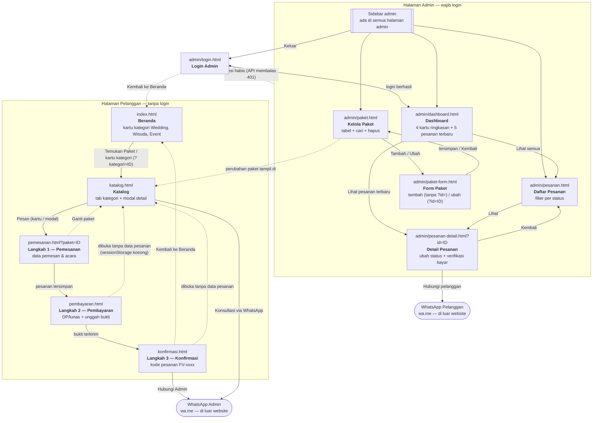
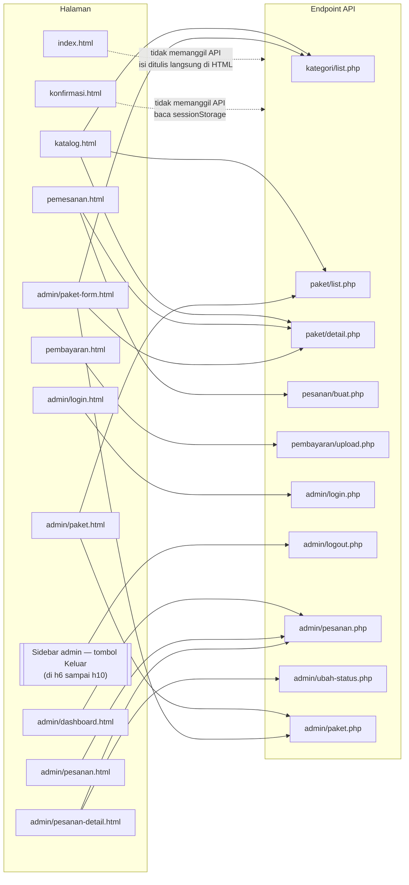

# Sitemap — Website Pemesanan Jasa Foto & Video

Sama seperti `ERD.md`, diagram di sini ditulis dengan **Mermaid** sehingga tetap
berupa teks: bisa dibaca dan diperbarui Claude Code, masuk ke git, dan tampil
otomatis sebagai gambar di GitHub dan VS Code.

---

## 1. Peta Halaman



Keterangan:

- **Garis putus-putus** = tautan balik, pengalihan otomatis, atau efek tidak
  langsung (bukan alur utama).
- **Navbar** (Beranda, Katalog) ada di semua halaman pelanggan, jadi tidak
  digambar satu per satu.
- **Sidebar admin** dimuat oleh `js/admin/layout.js` di kelima halaman admin.
  Tombol "Keluar" di sidebar memanggil `logout.php` lalu kembali ke login.
- **Tidak ada halaman "Cek Status Pesanan" untuk pelanggan.** Ini keputusan
  kelompok sejak awal: setelah mengirim bukti bayar, pelanggan diarahkan
  menghubungi admin lewat WhatsApp, dan admin yang mengabari perkembangan
  pesanannya. *(Catatan: file `api/pesanan/status.php` masih ada di
  repository walau tidak dipakai halaman mana pun. Kalau kelompok memutuskan
  menghapusnya atau membuat halamannya, perbarui diagram ini.)*
- `frontend/komponen.html` sengaja tidak dimasukkan: itu halaman uji tampilan
  komponen untuk pengembang, bukan bagian dari website.

---

## 2. Halaman dan Endpoint yang Dipanggil



- `index.html` belum memanggil API: kartu kategori dan harga "Mulai Rp..."
  ditulis langsung di HTML, jadi harus disamakan manual dengan isi database
  (lihat komentar di bagian KATEGORI pada `index.html`).
- `konfirmasi.html` sengaja tidak memanggil API sama sekali — seluruh datanya
  diambil dari `sessionStorage` yang sudah diisi `pemesanan.js` dan `bayar.js`,
  karena memang tidak ada endpoint publik untuk membaca pesanan berdasarkan kode.
- Halaman di `frontend/` memanggil API dengan `../api/...`, sedangkan halaman di
  `frontend/admin/` memakai `../../api/...`.

---

## 3. Daftar Halaman

| Halaman | Berkas | Pemilik | Login |
|---|---|---|---|
| Beranda | `frontend/index.html` | A | — |
| Katalog | `frontend/katalog.html` | A | — |
| Pemesanan | `frontend/pemesanan.html` | B | — |
| Pembayaran | `frontend/pembayaran.html` | B | — |
| Konfirmasi | `frontend/konfirmasi.html` | B | — |
| Login Admin | `frontend/admin/login.html` | C | — |
| Dashboard | `frontend/admin/dashboard.html` | C | wajib |
| Daftar Pesanan | `frontend/admin/pesanan.html` | C | wajib |
| Detail Pesanan | `frontend/admin/pesanan-detail.html` | C | wajib |
| Kelola Paket | `frontend/admin/paket.html` | A | wajib |
| Form Paket | `frontend/admin/paket-form.html` | A | wajib |

Komponen yang dimuat ke banyak halaman (bukan halaman berdiri sendiri):

| Komponen | Berkas | Pemilik | Dimuat oleh |
|---|---|---|---|
| Navbar | `frontend/komponen/navbar.html` | A | `js/komponen.js` (halaman pelanggan) |
| Footer | `frontend/komponen/footer.html` | A | `js/komponen.js` (halaman pelanggan) |
| Sidebar admin | `frontend/komponen/admin-sidebar.html` | C | `js/admin/layout.js` (halaman admin kecuali login) |

Halaman admin dilindungi di sisi server: setiap endpoint di `api/admin/`
(kecuali `login.php`) memanggil `cek_login()` dari `api/config/auth.php`.
Kalau session tidak ada, API membalas HTTP 401 dan `js/api.js` otomatis
mengalihkan ke halaman login.

---

## Cara Melihat Diagramnya

**Di VS Code:** pasang ekstensi *Markdown Preview Mermaid Support*
(`bierner.markdown-mermaid`), buka file ini, tekan `Ctrl+Shift+V`.

**Di GitHub:** push file ini, lalu buka di GitHub — diagramnya langsung tampil.

**Untuk laporan atau slide:** buka <https://mermaid.live>, paste isi salah satu
blok ```mermaid``` di atas, unduh sebagai PNG atau SVG.
